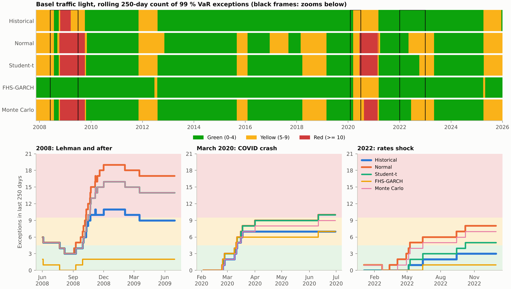
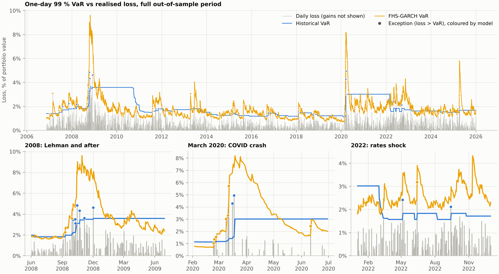

# Backtested VaR and Expected Shortfall: which model survives a crisis?

[](https://github.com/tancredeg/var-backtesting/actions/workflows/ci.yml)


Five one-day VaR / Expected Shortfall models (historical, normal, Student-t, GARCH-filtered
historical simulation, Monte Carlo with a copula) are forecast out of sample, without
look-ahead, on a five-ETF multi-asset portfolio over 4,812 days (Nov 2006 to Dec 2025) and
judged with Kupiec, Christoffersen, rolling Basel traffic lights and the Acerbi-Székely ES
test, to show which model fails in a crisis and why.

## Key results

<!-- RESULTS-TABLE:START -->
| Method | Level | Exceptions (expected) | Rate | Kupiec p | Christoffersen IND p | CC p | Z2 (p) | Worst zone | Days in red |
|---|---|---|---|---|---|---|---|---|---|
| Historical | 99 % | 50 (48.1) | 1.04% | 0.787 | < 0.001 | < 0.001 | — | red | 2.2% |
| Historical | 97.5 % | 124 (120.3) | 2.58% | 0.734 | < 0.001 | < 0.001 | -0.123 (0.060) | red | 7.2% |
| Normal | 99 % | 85 (48.1) | 1.77% | < 0.001 | < 0.001 | < 0.001 | — | red | 9.5% |
| Normal | 97.5 % | 150 (120.3) | 3.12% | 0.008 | < 0.001 | < 0.001 | -0.572 (< 0.001) | red | 5.9% |
| Student-t | 99 % | 69 (48.1) | 1.43% | 0.005 | < 0.001 | < 0.001 | — | red | 9.2% |
| Student-t | 97.5 % | 149 (120.3) | 3.10% | 0.011 | < 0.001 | < 0.001 | -0.393 (0.001) | red | 7.8% |
| FHS-GARCH | 99 % | 46 (48.1) | 0.96% | 0.757 | < 0.001 | < 0.001 | — | yellow | 0.0% |
| FHS-GARCH | 97.5 % | 121 (120.3) | 2.51% | 0.949 | 0.014 | 0.050 | -0.046 (0.219) | yellow | 0.0% |
| Monte Carlo | 99 % | 73 (48.1) | 1.52% | < 0.001 | < 0.001 | < 0.001 | — | red | 8.3% |
| Monte Carlo | 97.5 % | 168 (120.3) | 3.49% | < 0.001 | < 0.001 | < 0.001 | -0.483 (< 0.001) | red | 11.7% |

*Out-of-sample 2006-11-14 to 2025-12-31 (4,812 days); estimation window W = 500 days; Z2 at 97.5 % with 5,000 simulations under each model's own predictive distribution. Zones: Basel (1996) at 99 %; at 97.5 % the same binomial thresholds (Basel-equivalent, non-regulatory). Generated by `scripts/run_results.py`.*
<!-- RESULTS-TABLE:END -->



1. **Getting the number of exceptions right is not enough.** Historical simulation and
   FHS-GARCH pass Kupiec at both levels (50 and 46 exceptions at 99 % for 48.1 expected,
   p = 0.79 and 0.76). Normal, Student-t and Monte Carlo breach too often (85, 69 and 73;
   p ≤ 0.005).
2. **The timing of exceptions separates the models.** All five reject Christoffersen
   independence at 99 % (p < 0.001), but 43-49 % of the unconditional models' exceptions
   come within 10 trading days of the previous one, against 20 % for FHS (9.6 % if exceptions
   were independent). At 97.5 % FHS sits on the independent benchmark (22.5 % vs 22.4 %).
3. **Basel traffic light.** The four models without volatility dynamics turn red between
   9 and 22 October 2008 and peak at 11 to 19 exceptions in 250 days. FHS never goes beyond
   yellow: its peak is 9, after March 2020.
4. **Expected Shortfall.** Z2 rejects the 97.5 % ES of Normal, Student-t and Monte Carlo
   (p ≤ 0.0012), not of historical simulation (p = 0.060) or FHS (p = 0.22). Over
   February-April 2020 it rejects all five (p ≤ 0.0004).

### What fails in a crisis, and why

**Who.** The four unconditional models: historical, normal, Student-t, Monte Carlo. From
September 2008 to March 2009 (146 days, 1.5 exceptions expected at 99 %) they record 9 to
17 exceptions; FHS records 2.

**Why: exceptions cluster.** At 99 %, the Christoffersen statistic of historical simulation
comes almost entirely from clustering (LR_ind is 99 % of LR_cc). After an exception, the
probability of another one the next day is 10 % instead of 0.95 %. For normal, Student-t and
Monte Carlo, clustering is 54-76 % of the statistic; the rest is too many exceptions.

**Mechanism.** These models give equal weight to the last 500 days, so a regime change
reaches the VaR only as crisis losses enter the window.

- Historical 99 % VaR went from 1.98 % (12 Sep 2008) to only 3.44 % by 31 October, while
  21-day realised volatility reached 3.5 % a day (6 November).
- It then stayed above 2.5 % until November 2010. Zero exceptions in 2009 and 2010
  (2.5 expected each) offset the 11 of 2008. That is why the full-sample count looks right
  while the timing is wrong.

**The fix and its limit.** FHS rescales the historical residuals by a GARCH(1,1)
conditional volatility, so its VaR moves with the market. It reached 9.6 % on 29 October
2008, about twice the worst loss of the period (4.85 % on 15 October). It is conservative,
and backtests do not penalise that. FHS still fails in March 2020: portfolio volatility rose about ninefold in
five weeks (21-day volatility from 0.25 % to 2.27 % a day), faster than a daily GARCH
update can follow. The result is 7 exceptions at 97.5 % in February-April 2020 for 1.55
expected. All five pairs of consecutive FHS exceptions at 99 % fall in abrupt sell-offs:
April 2013 (gold), August 2015, February and March 2020, April 2025.



**Robustness.** With a 250-day window (`results/sensitivity_window250.csv`), FHS still
passes Kupiec at both levels and never turns red. Normal, Student-t and Monte Carlo still
fail all three coverage tests. Historical simulation no longer reaches red at 99 % (a shorter
window reacts faster), but it still fails independence (p < 0.001), and its ES is now
rejected (p = 0.003).

## Methodology

| Model | Tomorrow's loss distribution | Re-estimated |
|---|---|---|
| Historical | Empirical distribution of the last 500 portfolio losses | daily |
| Normal | N(sample mean, sample variance) of the last 500 returns | daily |
| Student-t | location-scale t; ν by maximum likelihood, (μ, s) by EM | ν every 21 days, (μ, s) daily |
| FHS-GARCH | σ̂_{t+1} × last 500 standardised GARCH(1,1) residuals | GARCH every 21 days (expanding), filter daily |
| Monte Carlo | 20,000 scenarios, t marginals per asset + Gaussian copula | ν_i every 21 days, rest daily |

- **Portfolio.** SPY 30 %, TLT 20 %, GLD 25 %, EEM 15 %, LQD 10 %, rebalanced daily. The loss
  is the negative simple return, so aggregation across assets is exact.
- **Data.** Yahoo Finance adjusted closes from 2004-11-18 to 2025-12-31. The snapshot is
  frozen and checked against a SHA-256 manifest before every run.
- **No look-ahead.** The forecast for day t sees only data up to t-1, as a read-only array. A
  property test perturbs future returns and checks that past forecasts are unchanged, for
  every model.
- **Estimators.** VaR is the type-6 quantile, which keeps the expected exception rate at its
  nominal value. ES is the Acerbi-Tasche tail mean. Normal and t VaR / ES use closed forms.
- **Tests.**
  - Kupiec POF and Christoffersen independence / conditional coverage, with asymptotic χ²
    p-values.
  - Basel traffic light on rolling 250-day counts at 99 %. The same binomial thresholds are
    applied at 97.5 %; this is a convention of the study, not a regulatory rule.
  - Acerbi-Székely Z2 at 97.5 %. Its p-values are simulated under each model's own
    predictive distribution (5,000 paths).

**Limitations (what the study does not do).**

- One-day horizon only, on a linear ETF portfolio. There are no liquidity or intraday effects.
  ETF prices can leave their NAV in stress: LQD lost 9.1 % and regained 9.8 % on 29-30
  September 2008.
- The data come from a single vendor; internal consistency checks are in the methodology notes.
- GARCH is symmetric (no leverage effect), and the Gaussian copula has no tail dependence.
- Monte Carlo ES carries simulation noise: up to 9 % relative standard deviation at 99 % on
  stressed dates (`results/mc_noise.csv`).
- Crisis windows are too short for χ² p-values, so crisis tables report counts. Only Z2,
  whose p-values are simulated, is tested by sub-period.

Details and derivations: [docs/methodology.md](docs/methodology.md).

## Reproduce

```bash
pip install -e ".[dev]"          # Python >= 3.12, pinned dependencies
python scripts/run_results.py    # ~8 min: every table in results/, every figure, the table above
```

`pytest` runs the 126 tests in about 30 s (coverage 99 % of `src/var_es`).
`notebooks/demo.ipynb` reads `results/` and runs in a few seconds.

## Code structure

```
src/var_es/
  config.py           every tunable (weights, levels, windows, seeds) in one frozen dataclass
  data.py             snapshot loading + SHA-256 check;  portfolio.py  rebalanced portfolio return
  measures.py         empirical and closed-form VaR / ES;  distributions.py  Student-t MLE (EM + profile)
  predictive.py       predictive loss distributions (VaR, ES, sampling) shared by all models
  models/             historical.py, parametric.py (normal, t), fhs.py (GARCH filter), montecarlo.py
  forecast.py         rolling engine: data <= t-1 only, fixed refit calendar, Z2 null simulation
  backtest/           coverage.py (Kupiec, Christoffersen), traffic_light.py (Basel), es_test.py (Z2)
  analysis.py         result tables;  plotting.py  figures
scripts/              download_data.py (one-off), run_results.py, make_sample.py, update_regression_baseline.py
tests/                known laws, reference cases (Jorion, Basel 1996, Acerbi-Székely), look-ahead, regression
data/                 frozen snapshot + MANIFEST.json;  data/sample/  2019-2020 extract for regression tests
results/  figures/    generated by scripts/run_results.py
docs/methodology.md   formulas, choices and limitations
```

## References

- Acerbi, C. and Székely, B. (2014). Backtesting Expected Shortfall. *Risk*.
- Acerbi, C. and Tasche, D. (2002). On the coherence of Expected Shortfall. *Journal of Banking & Finance* 26(7).
- Barone-Adesi, G., Giannopoulos, K. and Vosper, L. (1999). VaR without correlations for portfolios of derivative securities. *Journal of Futures Markets* 19(5).
- Basel Committee on Banking Supervision (1996). Supervisory framework for the use of "backtesting" in conjunction with the internal models approach to market risk capital requirements.
- Christoffersen, P. (1998). Evaluating interval forecasts. *International Economic Review* 39(4).
- Hull, J. and White, A. (1998). Incorporating volatility updating into the historical simulation method for value-at-risk. *Journal of Risk* 1(1).
- Jorion, P. (2007). *Value at Risk*, 3rd ed.
- Kupiec, P. (1995). Techniques for verifying the accuracy of risk measurement models. *Journal of Derivatives* 3(2).
- McNeil, A., Frey, R. and Embrechts, P. (2015). *Quantitative Risk Management*, revised ed.
